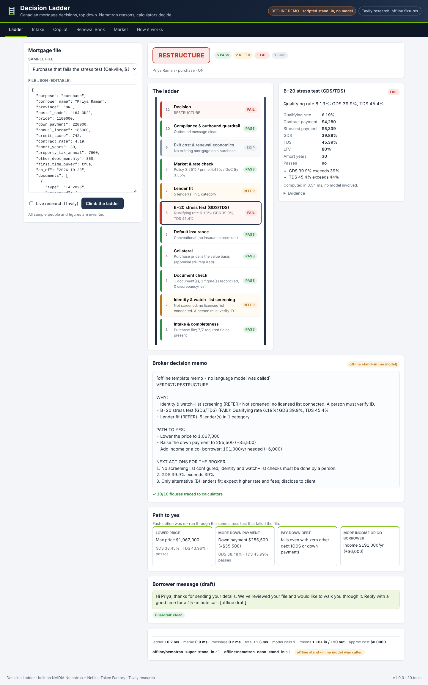
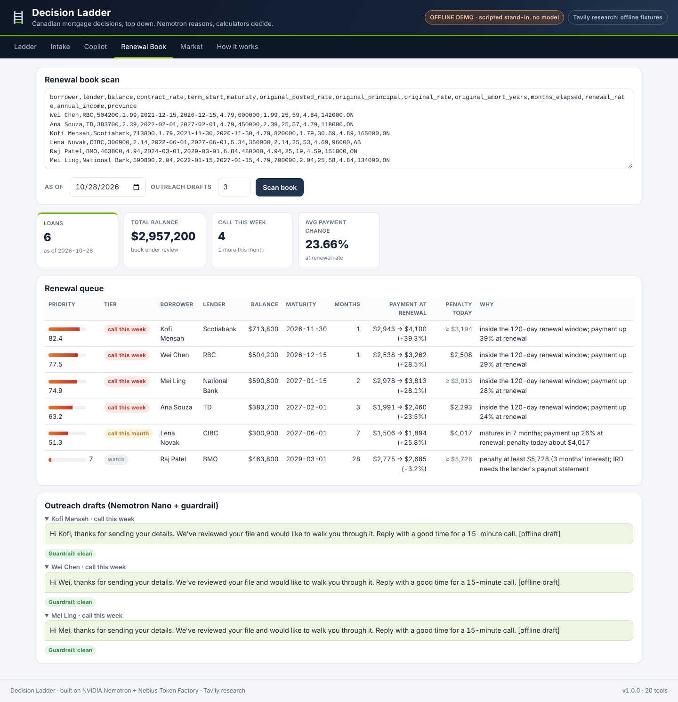
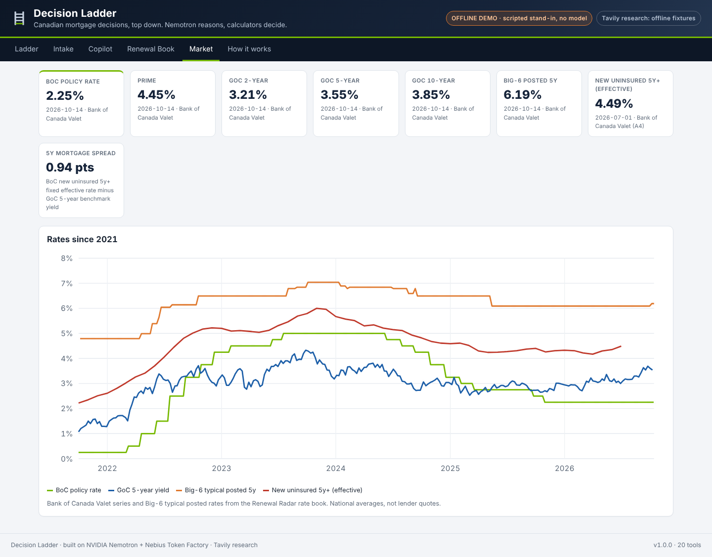

# Decision Ladder

**Canadian mortgage decisions, top down. Nemotron reasons; calculators decide.**

Decision Ladder takes a mortgage file and moves it up eleven rungs, from intake to a decision a licensed broker can act on. **NVIDIA Nemotron**, served by **Nebius Token Factory**, plans the work, reads client emails, calls tools, and writes the broker's decision memo and the client message. Tested deterministic engines do every calculation: the OSFI B-20 stress test, default-insurance premiums, lender-specific prepayment penalties, renewal shock and the rate book. A **provenance verifier** checks every figure in the model's text against the tool results and marks anything it can't trace. **Tavily** brings in news the dated rate book doesn't have yet, searching official Canadian sources only.

*By John Khan, a licensed mortgage broker (Ontario) and data scientist. Not lending advice: every output is an estimate for a licensed broker to confirm.*

> **Hackathon:** Nebius × NVIDIA Global AI Hackathon 2026, *Best Apps and Agents* track.
> **NVIDIA open models:** Nemotron 3 Super (reasoner) and Nemotron 3 Nano (fast extraction and drafting), both called through Nebius Token Factory's OpenAI-compatible API.
> **Runs with zero dependencies:** Python 3.10+ standard library only. `python -m decision_ladder serve --offline` works with no keys.



| Renewal book scan | Market (rate book) |
|---|---|
|  |  |

*Screenshots are from offline demo mode (labelled in the header). In live mode the badge reads "LIVE · NVIDIA Nemotron … on Nebius Token Factory".*

---

## The ladder

```
 11  DECISION        GO / GO WITH CONDITIONS / RESTRUCTURE / DECLINE AS STRUCTURED  + path to yes
 10  COMPLIANCE      outbound-message guardrail, FSRA disclosure checklist
  9  EXIT COST       lender-method IRD penalty, renewal shock, offer comparison, refinance break-even
  8  MARKET          BoC policy rate, prime, GoC curve, effective new-lending rates vs the file's rate
  7  LENDER FIT      lender categories whose policy fits province, score, LTV, GDS, TDS
  6  QUALIFICATION   OSFI B-20 stress test (purchase) or switch/refinance stress check (renewal)
  5  INSURANCE       default-insurance premium, PST at closing, minimum down payment, 30-yr rules
  4  COLLATERAL      value basis (price, stated value or regional index estimate), LTV
  3  DOCUMENTS       stated vs document figures reconciled
  2  SCREENING       identity / watch-list interface (honest: NOT_SCREENED without a licensed list)
  1  INTAKE          completeness for purchase / renewal / refinance
```

Every rung returns `PASS`, `REFER`, `FAIL` or `SKIP`. If a rung crashes, it returns `REFER` with the error; a crash never counts as a pass. When the stress test fails, the ladder works out a **path to yes**: the highest price that passes, the smallest down payment that passes, the debt payoff needed, the income or co-borrower needed, and whether a 30-year amortization helps. Each option is re-run through the same stress test that failed the file, so an option can't disagree with the decline.

## Where Nemotron does the work

| Job | Model | How it is kept honest |
|---|---|---|
| **Broker copilot**: free-form questions, multi-tool plans (19 calculator/data tools + `web_research`) | Nemotron 3 Super | Must call tools for any number. The verifier checks the answer. One repair turn, then unsupported figures are marked `[unverified]` |
| **Decision memo** from the ladder results | Nemotron 3 Super | Same verifier against the ladder JSON. Falls back to a deterministic template if the model fails |
| **Intake**: client email → structured file | Nemotron 3 Nano (JSON mode) | Every value must quote the exact source text. Values with ungrounded quotes are dropped. Disagreements with the pattern extractor are flagged, never silently resolved |
| **Client message drafts** (file status, renewal outreach) | Nemotron 3 Nano | Outbound guardrail blocks rate quotes, approval promises, guarantees, pressure language and requests for SIN, passwords or cards |

All model calls go through one small client (`decision_ladder/llm/client.py`) that speaks Token Factory's OpenAI-compatible Chat Completions API using only `urllib`. It handles tool calls, JSON mode (with a fallback if the server rejects `response_format`), `<think>` stripping, retries with backoff on 408/429/5xx, and per-model token and cost accounting.

## Tavily

`web_research` searches with Tavily and is restricted by default to official domains: bankofcanada.ca, osfi-bsif.gc.ca, canada.ca, fsrao.ca, cmhc-schl.gc.ca, fcac-acfc.gc.ca, statcan.gc.ca, bcfsa.ca, reca.ca and fin.gc.ca. A `lenders` scope covers the big lenders' own sites instead. Results are truncated and returned with their URLs, so the model can cite them, and the UI lists them under the memo. The ladder can attach research (for example, "Bank of Canada interest rate announcement") to a run, so the memo reflects events newer than the rate book.

## The data and engines (deterministic, tested)

- **Rate book** (`data/rates_5yr.csv`, 13,900+ rows): BoC Valet policy rate, prime, GoC 2/3/5/7/10-year yields, Big-6 typical posted rates, BoC A4 effective rates on new and outstanding loans (insured and uninsured), and each Big-6 bank's own posted and special rates as captured by Renewal Radar. Every value carries its date and source. Gap-fill values are labelled as gap-fill.
- **Lender-method penalty engine** (`penalty/`, Decimal arithmetic): posted-minus-discount, CIBC discount add-back, present-value and simple-differential methods. It handles comparison-term rules (nearest, round up/down, interpolate), day counts and month rounding, and reports how much each term rule alone would move the result. These methods come from Renewal Radar, where they were checked against lenders' own published calculators.
- **B-20 qualification**, GDS/TDS, insured-mortgage rules from Dec 15, 2024 ($1.5M cap, 30-year amortization for first-time buyers and new builds), the default-insurance premium schedule, Canadian semi-annual compounding, renewal shock, offer comparison, the switch check (OSFI's Nov 21, 2024 straight-switch rule), refinance break-even and a regional home-value index.
- **Renewal book scan**: upload a CSV of a broker's book and get a ranked call queue (urgency, payment shock, size), today's penalty by lender method, and guardrailed outreach drafts.

## Quick start

```bash
git clone https://github.com/ALENZACODES/decision-ladder && cd decision-ladder

# 1. No keys: offline demo (scripted stand-in, clearly labelled, no model calls)
python -m decision_ladder demo --offline
python -m decision_ladder serve 8000 --offline      # http://localhost:8000

# 2. Live on Nebius Token Factory with NVIDIA Nemotron
export NEBIUS_API_KEY=...          # tokenfactory.nebius.com -> API keys
export TAVILY_API_KEY=...          # optional, enables live research
python -m decision_ladder models   # lists the models your key can use (NVIDIA ones are marked)
python -m decision_ladder smoke    # end-to-end live check, writes smoke_report.json
python -m decision_ladder serve 8000

# Other commands
python -m decision_ladder ask "What is the penalty to break a TD mortgage: balance 640000 at 5.29%, term 2023-08-01 to 2028-08-01, posted at funding 6.84%, payout 2026-10-28?"
python -m decision_ladder intake client_email.txt
python -m decision_ladder book my_book.csv 2026-10-28
python -m decision_ladder eval     # copilot evaluation: tool selection, accuracy, provenance

pip install pytest && pytest -q    # the test suite needs no network and no keys
```

If Token Factory renames a model, set `DL_MODEL_REASONER` / `DL_MODEL_FAST` to an ID shown by `python -m decision_ladder models`.

## Deploy

**Nebius AI Cloud (VM):** create a small CPU VM in the Nebius console, SSH in, then:

```bash
git clone https://github.com/ALENZACODES/decision-ladder && cd decision-ladder
docker build -t decision-ladder .
docker run -d --restart unless-stopped -p 80:8000 \
  -e NEBIUS_API_KEY=... -e TAVILY_API_KEY=... -e DL_RATE_PER_MIN=12 decision-ladder
```

**Render:** `render.yaml` is included (Docker, free plan). Add `NEBIUS_API_KEY` and `TAVILY_API_KEY` as secrets.

Model-backed endpoints are rate-limited per IP (`DL_RATE_PER_MIN`), so a public demo URL can't use up your Token Factory credits.

## API

| Method | Path | Body | Returns |
|---|---|---|---|
| GET | `/api/health` | | mode (live/offline), model IDs, research mode |
| GET | `/api/samples` | | sample files, a sample client email, a sample renewal book |
| GET | `/api/tools` | | the tool specs Nemotron sees |
| GET | `/api/market`, `/api/history` | | rate-book snapshot and series |
| POST | `/api/ladder` | `{file, research?, memo?, message?}` | rungs, verdict, memo, verification, message, research, usage |
| POST | `/api/intake` | `{text, run?}` | extracted file with quotes, conflicts, dropped values (+ ladder run) |
| POST | `/api/ask` | `{question, context?, history?}` | answer, verification, tool trace, usage |
| POST | `/api/book` | `{csv, as_of?, drafts?}` | ranked renewal queue |
| POST | `/api/tool` | `{name, args}` | direct tool call, no model (for testing tools in CI) |

## Tests and evaluation

- `pytest -q` runs the suite: client wire format and retries, verifier rounding rules, every tool, every rung, sample verdicts, the copilot repair loop with a scripted Nemotron, intake grounding, the book scan, and the HTTP server. Penalty-engine tests come from Renewal Radar.
- `python -m decision_ladder eval` runs `evals/cases.json` against the live model. It measures tool selection, answer accuracy (expected figures are computed by calling the tools directly, never typed by hand) and provenance. Results go to `eval_report.json`. In `--offline` mode it only tests the plumbing.

## Built on prior work (disclosed)

Decision Ladder brings together two of my earlier October 2026 projects and adds a new agentic layer on top:

- **Renewal Radar** (Oct 2026): the lender-method penalty engine (`decision_ladder/penalty/`, with its tests) and the rate-watch data in `decision_ladder/data/`.
- **MortgageLoanOps** (Oct 2026, MIT): qualification, insured rules, payments, IRD quick estimate, lender categories, screening interface, guardrail and home-value index (`decision_ladder/engines/`).

New for this hackathon: the Token Factory client, the offline stand-in, the ladder and its rungs, the path-to-yes solvers, the insurance premium engine, renewal and switch economics, the rate-book API, the copilot tool loop, the provenance verifier and repair loop, grounded intake extraction, Tavily research, the renewal book scan, the web app, the evals, the smoke test and the deployment files.

## Limitations

- **Estimates, not advice.** A licensed broker must confirm every figure. The lender's written payout statement decides the actual penalty.
- **Lender policy** in the lender-fit rung is illustrative and set by category (`panel_verified` is false). It is not any lender's live guidelines.
- **Screening** ships with no sanctions or PEP data and never reports anyone as cleared.
- **Home value** is a regional-index estimate, not an appraisal.
- **The rate book** is a dated snapshot (latest rows mid-October 2026). Tavily research is how the system sees anything newer.
- **The verifier** matches numbers, not meaning. It catches invented figures, but it can't tell whether a real figure is attached to the right claim.
- **Live model behaviour** depends on the model version Token Factory serves. Run `smoke` and `eval` to measure it on your key.

## License

MIT. See [LICENSE](LICENSE).
