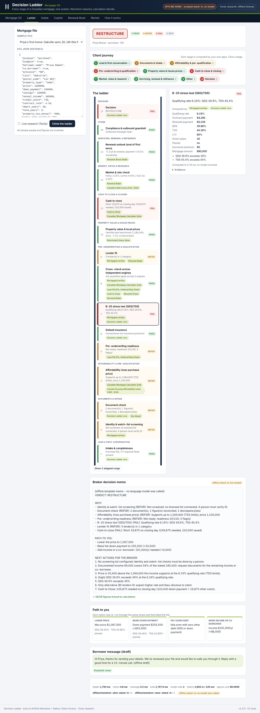

# Decision Ladder: Mortgage OS

[](https://github.com/ALENZACODES/decision-ladder/actions/workflows/tests.yml)

**Every stage of a Canadian mortgage, one system. Nemotron reasons; calculators decide.**

Decision Ladder is an operating system for a Canadian mortgage file, from the first email to closing day, then to renewal five years later, and on to commercial deals. It runs **21 modules built from 20 of my own repositories** inside one app: 79,503 lines of their code (counted by the code itself, below), each with its own screen, calculators, notebooks or tests. An agent built on **NVIDIA Nemotron**, served by **Nebius Token Factory**, drives all of them.

- **Nemotron 3 Nano** routes every question to the right apps, reads client emails and documents, and drafts client messages.
- **Nemotron 3 Super** plans and runs tool calls across the apps' 50 tools.
- **Nemotron 3 Ultra** writes the final credit decision. The hackathon brief says to "reach for Nemotron 3 Ultra when you need serious reasoning".
- **Tavily** reads official Canadian sources and the lenders' own rate pages.
- **Every number comes from tested code.** Every figure the models write is checked against those results, and anything that can't be traced is flagged.

*By John Khan, a licensed mortgage broker (Ontario) and data scientist. Not lending advice: every output is an estimate for a licensed broker to confirm.*

> **Nebius × NVIDIA Global AI Hackathon 2026, Best Apps and Agents track.**
> NVIDIA open models: Nemotron 3 Nano, Super and Ultra on Nebius Token Factory. The app deploys as a Nebius Serverless AI endpoint, and the nightly renewal-book scan runs as a Nebius Serverless AI job.

---

## One client, start to finish

Priya emails her broker: a $1.1M semi in Oakville, $220K saved, a 4.19% offer from her bank. Her file goes up a 17-rung ladder. Each rung is computed by one of my apps, with no language model inside the rung:

| Stage | Rung | Computed by (my app) | What it found for Priya |
|---|---|---|---|
| Lead | Intake | Nemotron Nano + pattern extractor | 15 fields from her email. Each value quotes the sentence it came from |
| Documents | Document check | Document reader + **Doc Quest** | Her pay stub, annualized, documents $99,000 of the $185,000 stated. The co-borrower's income still needs documents |
| Pre-qualification | Affordability | **Canadian Mortgage Suite** + **Affordability Index 1980-2026** | Supports $1,064,600; the price is $1,100,000 |
| Underwriting | Readiness | **Loan File Pre-Underwriting Check** | Not ready: 20/100, with GDS/TDS flags and missing documents |
| Underwriting | B-20 stress test | **MortgageLoanOps** | Fails: GDS 39.9%, TDS 45.4% at 6.19% |
| Underwriting | Cross-check | 5 independent engines | 4 of 4 quantities agree to the cent (see below) |
| Property | Local prices | **Benchmark Home Value** | Oakville semi benchmark $1,185,000; her price is 7.2% below it |
| Closing | Cash to close | **Cash to Close** | **Short $19,875** on closing day. Path to close: put $197,500 down, keeping cash for closing costs |
| Market | Rates | Rate book (**Renewal Radar** data) + **Canada's Rate Cycle** | Policy rate 2.25%; this cycle's peak was 5% (2023-07) |
| Servicing | Renewal outlook | **Renewal Shock Radar** | At +1 point in 5 years, her payment rises about 10.5% (moderate) |
| Decision | Verdict | Decision Ladder | **RESTRUCTURE**, with a path to yes: lower the price, add down payment or income, or keep cash for closing |

Five years later, her renewal goes through **Renewal Radar**: it reads the letter, checks the switch pathway, writes a negotiation script, and computes a lender-exact penalty. A commercial deal goes through the **Private Credit Deal Screener**, which reports DSCR, debt yield, a letter grade, and which assumption moves the grade most.



## The modules (my projects, running inside the OS)

| Module | Stage(s) | Lines | Tools Nemotron can call | Original |
|---|---|---:|---|---|
| Renewal Radar | servicing, documents, market | 51,275 | `rr_letter_xray`, `rr_bank_penalty` (lender-exact), `rr_switch_pathway`, `rr_negotiation_script`, `rr_renewal_plan`, `rr_penalty_forecast`, `rr_penalty_helper`, `rr_wait_economics`, `rr_lead_score`, `rr_broker_book_review`, `rr_penalty_accuracy` | [live](https://renewal-radar-nplp.onrender.com) |
| Canada Home Value | property | 6,401 | `valuation_accuracy` | |
| Benchmark Home Value | property, pre-qualification | 5,453 | `benchmark_home_price`, `postal_area_home_value`, `index_purchase_to_today` | [live](https://alenzacodes.github.io/benchmark-home-value/) |
| Canadian Mortgage Calculator Suite | pre-qualification, closing, servicing | 3,035 | `land_transfer_tax`, `closing_costs_estimate`, `affordability_by_income`, `refinance_cash_out`, `down_payment_savings_plan` | [live](https://alenzacodes.github.io/canadian-mortgage-suite/) |
| MortgageLoanOps | underwriting, servicing | 2,282 | `qualify_purchase`, `insurance_premium`, `penalty_quick`, `lender_match`, `message_guardrail`, `identity_screening` | |
| Mortgage Decision Lab | pre-qualification, servicing | 1,312 | `rent_vs_buy`, `prepayment_savings` | [live](https://alenzacodes.github.io/mortgage-decision-lab/) |
| Renewal Check | servicing | 1,264 | `renewal_offer_check` | [live](https://alenzacodes.github.io/renewal-check/) |
| Private Credit Deal Screener | commercial | 1,039 | `private_credit_deal_screen` | [live](https://alenzacodes.github.io/private-credit-screener/) |
| Loan File Pre-Underwriting Check | underwriting, documents | 977 | `pre_underwrite_loan_file` | [live](https://alenzacodes.github.io/pre-underwriting-copilot/) |
| Cash to Close | closing | 964 | `cash_to_close_ontario` | [live](https://alenzacodes.github.io/cash-to-close/) |
| Renewal Shock Radar | servicing, market | 957 | `renewal_shock_band` | [live](https://alenzacodes.github.io/renewal-shock-radar/) |
| Doc Quest | documents, lead | 725 | `buyer_document_checklist` | [live](https://alenzacodes.github.io/doc-quest/) |
| Canada's Rate Cycle 2015-2026 | market | 635 | `rate_cycle_history` | [live](https://alenzacodes.github.io/canada-rate-cycle-dashboard/) |
| Canada Housing Affordability Index 1980-2026 | market, pre-qualification | data | `housing_affordability_index`, `affordability_rate_sensitivity` | [Kaggle](https://www.kaggle.com/code/johnnykhan1/canada-housing-affordability-index-1980-to-2026) |
| Quiet Charges | documents, underwriting | 957 | `recurring_charges_scan` | [live](https://alenzacodes.github.io/quiet-charges/) |
| Shoebox | documents, underwriting | 750 | `self_employed_expense_lines` | [live](https://alenzacodes.github.io/shoebox/) |
| RenewalCheck pitch deck | lead, servicing | 713 | (presentation) | [live](https://alenzacodes.github.io/renewal-check-pitch/) |
| Who Sets Canada's 5 Year Mortgage Rate? (notebook) | market | 180 | `rate_spreads` | repo |
| Canada's Renewal Wave: 2020 and 2021 Fixed Rates (notebook) | market, servicing | 171 | (data) | repo |
| Real Interest Rates in Canada Since 2009 (notebook) | market | 150 | `rate_spreads` (CPI) | repo |
| Bank of Canada Kaggle dataset notebooks (2 of 4) | market | 97 | `rate_spreads` (nowcast) | repo |

The line counts are produced by the code (`python -m decision_ladder os`): `.py`, `.js`, `.mjs`, `.ts`, `.html`, `.css` and `.sql` files in `modules/`, plus only the **code cells** of `.ipynb` notebooks (markdown and notebook JSON are not counted), excluding minified vendor files. Total: **79,503 lines in `modules/`** by that counter (79,639 if shell and PowerShell scripts are included). The OS layer (`decision_ladder/`, tests, evals, scripts, desk pages) adds 20,541 lines, including the five desks below (8,710 lines). The repository holds **100,180 lines of code** (`.py .js .mjs .ts .html .css .sql .sh .ps1` plus notebook code cells, as of this commit). Data files and the Shoebox model weights are not counted.

**How the modules are wired:**
- **Each app opens inside the OS.** The Mortgage OS tab maps all nine lifecycle stages, and every app is served at `/apps/<module>/`.
- **The JavaScript apps run their own code.** Their calculators run through a small Node bridge (`decision_ladder/modules/bridge.mjs`) that loads each app's own `calc.js` / `engine.js` / `logic.js`, so the agent, the ladder and the app's screen always give the same number. All nine apps' own test suites pass inside the OS, and CI runs them.
- **Renewal Radar runs in-process.** It's a FastAPI app; its engines are imported in-process for tools, and its full app is proxied at `/apps/renewal-radar/`.

## Desks: the rest of a broker's day

Five desks written for this submission (not from my earlier repos), each a Python engine with Nemotron tools, tests and its own page at `/static/desks/<name>.html`. Every rule they apply was checked against the official source on 2026-10-29 and is cited in the results; lender-policy figures are labelled as such.

| Desk | What it does | Tools | Lines |
|---|---|---|---|
| Commercial Lending | CMHC MLI Select points and MLI Standard sizing, conventional sizing (LTV / DSCR / debt yield, names the binding constraint), construction draws with Ontario's 10% holdback and interest reserve, private / bridge true cost (IRR), rent roll (WALT, rollover) | 6 | 1,715 |
| Business Lending | CSBFP eligibility, limits and fees; invoice factoring true cost; term loans, lines and merchant cash advances checked against the Criminal Code rate (35% / 48% business tier); business and global DSCR; equipment lease vs buy with CCA | 10 | 1,816 |
| Income & Rental Qualification | qualifying income by type (2-year averages, declining-income rule, self-employed add-backs or 15% gross-up), rental add-back vs offset vs net-rental compared on one file, investor portfolio, max price and rent needed | 6 | 1,347 |
| Servicing | dated schedules for all six Canadian payment frequencies, variable-rate trigger rate and trigger point, prepayment privileges with any excess priced by the penalty engine, blend-and-extend vs break, port and increase, HELOC 65% / 80% room, payment deferral | 9 | 1,951 |
| Disclosure & Compliance | Ontario cost of borrowing and APR (O. Reg. 191/08) with the federal formula for comparison, Interest Act ss. 6, 8 and 10, FSRA and RECA conduct checklists, FINTRAC identity and record-keeping, renewal statement timing (21 days) | 8 | 1,881 |

The ladder uses two of them directly: the commercial rung sizes the take-out loan for a bridge (on the Hamilton sample it comes out $39,715 short of the bridge balance at an assumed 6% take-out rate), and the compliance rung produces the Ontario APR and checks renewal statement timing.

## Cross-checks: my apps check each other

I built several of these calculators separately, in Python and JavaScript, at different times. Where two or more compute the same quantity, the OS runs all of them on the same inputs and shows whether they agree (`decision_ladder/ladder/crosscheck.py`).

On the sample files, **every overlapping quantity agrees to the cent**:

| Quantity | Engines that agree |
|---|---|
| Ontario land transfer tax and first-time-buyer refund | Cash to Close, Canadian Mortgage Suite |
| Default-insurance premium | Decision Ladder engine (Python), Canadian Mortgage Suite (JS) |
| B-20 qualifying rate | MortgageLoanOps, Canadian Mortgage Suite, Pre-Underwriting Check |
| Qualifying payment | MortgageLoanOps, Pre-Underwriting Check |
| Payment at renewal | MortgageLoanOps, Renewal Check |
| IRD penalty (posted-minus-discount) | Renewal Radar's Decimal engine, MortgageLoanOps, Renewal Check: all three at $17,013.33 |

The cross-check also surfaces real differences instead of hiding them:

- **TD's own calculator method**, reproduced in Renewal Radar, counts the time left day-exact (21.16 months) and gives **$16,363.73**. The three generic engines round up to 22 months. The OS shows this as a labelled known difference and uses the lender-exact figure.
- **It found a bug in one of my own engines during integration.** MortgageLoanOps qualified insured files on the loan *before* the CMHC premium; the Suite qualified on loan + premium, which is what lenders do. The OS engine now includes the premium, and a test covers it.

## Where Nemotron, Token Factory, Tavily and Nebius Serverless fit

| Job | Model / service | Kept honest by |
|---|---|---|
| **Routing**: which lifecycle stages a question touches | Nemotron 3 Nano (JSON) | Super only sees those apps' tools (e.g. 12 of 52). If routing fails, it falls back to keywords, then to all tools |
| **Intake**: client email → structured file; documents (pay stub, T4, NOA, employment letter, renewal letter) → figures | Nemotron 3 Nano (JSON) + deterministic readers | Every value must quote its source text; ungrounded values are dropped; disagreements are flagged |
| **Copilot**: multi-tool plans across the apps | Nemotron 3 Super (tool calling) | The provenance verifier checks every figure; one repair turn, then `[unverified]` |
| **Credit decision memo** over the whole journey | Nemotron 3 Ultra (falls back to Super if Ultra isn't available to your key) | Same verifier against the ladder results; deterministic template if the model fails |
| **Client messages** (status, renewal outreach) | Nemotron 3 Nano | Outbound guardrail: no rate quotes, approval promises, pressure, or requests for SIN, passwords or cards |
| **Research** (Bank of Canada, OSFI, FSRA, CMHC, Canada.ca) | Tavily Search, official domains only | Every source cited by URL |
| **Is the rate book stale?** | Tavily Extract on each bank's own rate page | The posted 5-year rate is confirmed on the page, or flagged as changed |
| **Inference** | Nebius Token Factory, OpenAI-compatible API | Standard-library client: tool calls, JSON mode, retries, `<think>` stripping, recovery of inline tool calls (Qwen3-Coder XML / `<TOOLCALL>`), model auto-resolution against `/v1/models`, per-model token and cost accounting |
| **Hosting** | Nebius Serverless AI endpoint (`deploy/nebius/endpoint.sh`) | CPU only; Nemotron runs on Token Factory |
| **Nightly renewal-book scan** | Nebius Serverless AI job (`deploy/nebius/job.sh`) | Billed only while it runs; writes a ranked call queue with Nano outreach drafts |

## Quick start

```bash
git clone https://github.com/ALENZACODES/decision-ladder && cd decision-ladder
# needs Python 3.10+ and Node.js 18+ (Node runs the JavaScript apps' own calculators)

# No keys: offline demo (scripted stand-in, labelled everywhere, no model calls)
python -m decision_ladder serve 8000 --offline        # http://localhost:8000
python -m decision_ladder os                          # the modules, stages and tools
python -m decision_ladder demo --offline              # every sample file up the ladder

# Live: NVIDIA Nemotron on Nebius Token Factory (+ Tavily)
#   Windows: double-click "Go Live.cmd"     macOS/Linux: bash scripts/go_live.sh
#   (asks for the keys, lists models, runs the live smoke test and the eval, then opens the app)
export NEBIUS_API_KEY=...  TAVILY_API_KEY=...
python -m decision_ladder models      # Nemotron IDs your key can use (Nano / Super / Ultra resolved automatically)
python -m decision_ladder smoke       # live end-to-end check -> smoke_report.json
python -m decision_ladder eval        # 17 copilot cases: tool choice, accuracy, provenance -> eval_report.json
python -m decision_ladder serve 8000

# Background job (locally, or as a Nebius Serverless AI job)
python -m decision_ladder job renewal-book --input book.csv --out out/ --drafts 5

pip install pytest && pytest -q       # needs no network and no keys
```

Renewal Radar's own app and its extra tools need `pip install -r modules/renewal-radar/requirements.txt`. Without them, the rest of the OS still runs, and those tools return a clear error.

**Model IDs.** At startup the server checks the configured IDs against `/v1/models` and picks the visible Nemotron Nano, Super and Ultra models. The choice is reported in `/api/health`. To pin a model, set `DL_MODEL_FAST`, `DL_MODEL_REASONER` or `DL_MODEL_ULTRA`.

**Reasoning mode.** Nemotron 3 reasons by default. Decision Ladder sends `chat_template_kwargs: {"enable_thinking": false}`, because the calculators do the thinking that has to be exact. Set `DL_THINKING=1` to turn reasoning on for Super and Ultra. If an endpoint rejects the flag, the client stops sending it and retries the call once.

## Deploy

- **Nebius Serverless AI endpoint:** run `deploy/nebius/endpoint.sh`. It uses the image that the `container image` workflow publishes to `ghcr.io/alenzacodes/decision-ladder`, on the CPU platform `cpu-d3` with preset `4vcpu-16gb` and port 8000.
- **Nebius Serverless AI job:** run `deploy/nebius/job.sh` for the nightly renewal-book scan.
- **Nebius AI Cloud VM, or Render:** see [docs/DEPLOY.md](docs/DEPLOY.md). `render.yaml` and the `Dockerfile` (Python, Node and Renewal Radar's dependencies) are included.

Model-backed endpoints are rate-limited per IP (`DL_RATE_PER_MIN`), so a public demo can't use up the Token Factory credits.

## API

| Method | Path | Body | Returns |
|---|---|---|---|
| GET | `/api/os` | | stages, modules (lines, tools, UI URL), totals |
| GET | `/apps/<module>/...` | | the module's own app, served or proxied |
| GET | `/api/health` | | mode, Nemotron Nano / Super / Ultra IDs and how they were resolved, module load errors |
| POST | `/api/ladder` | `{file, research?, memo?, message?}` | 17 rungs with stage and engines, verdict, memo (+ memo model), verification, research |
| POST | `/api/intake` | `{text, documents?, run?}` | extracted file with quotes, document readings, conflicts (+ ladder run) |
| POST | `/api/document` | `{text}` | one document: type, figures, quotes |
| POST | `/api/ask` | `{question, context?, history?}` | answer, routing (stages, tools offered), apps used, verification, trace |
| POST | `/api/book` | `{csv, as_of?, drafts?}` | ranked renewal queue with lender-exact penalties |
| POST | `/api/tool` | `{name, args}` | direct tool call, no model |

## Live results (Nemotron on Nebius Token Factory)

Measured on 2026-10-29 by the `live` workflow on GitHub's runners with my Token Factory key (run 40894783422; the raw reports are on the [`live-results`](https://github.com/ALENZACODES/decision-ladder/tree/live-results) branch). No offline stand-in is involved in these numbers.

| Check | Result |
|---|---|
| Nemotron models visible to the key | 5: Nano 30B-A3B, Super 120B-A12B, **Ultra 550B-A55B**, 3.5 Super VL, 3.5 Lightning |
| Smoke test (models, Super tool calling, copilot provenance, Nano extraction, Ultra memo, memo provenance) | **8/8** |
| Eval, 17 cases, Super with Nano routing: right tool | **16/17** |
| Eval: answer matches the tool-computed figure | **13/14** |
| Eval: every figure traced to a tool (after at most one repair turn) | **15/17**; the other 2 carry visible `[unverified]` marks |
| Ultra decision memos, all 5 sample files | **5/5 fully traced** (16 to 29 figures each) |
| Cost | about $0.18 for the eval and $0.02 for the smoke test (token counts in the reports) |

What the first live run (40892144934) caught and what changed:
- the verifier read "APR 4.19%" as the date "April 4", flagging correct figures; fixed, with a test;
- Super once returned an empty reply after long tool results; the client now retries once with an explicit nudge;
- Nano sometimes routed "break a TD mortgage" or a renewal question away from the servicing tools; keyword stages are now added to Nano's choice (eval tool choice went from 14/17 to 16/17);
- Ultra once computed an "$86,000 income gap" itself; the verifier flagged it, as designed.

Remaining misses in the latest eval: in one case Super passed slightly different inputs to `max_purchase_price` and quoted $710,000 instead of $689,000 (the figure was traced to its own tool call but not to the expected inputs); for the renewal-letter question it asked for the current payment instead of calling a tool.

## Tests and evaluation

- **OS test suite:** `pytest -q`. It covers the client wire format and retries; the three-tier routing and Ultra fallback; the verifier; every core tool; every rung; the module tools against each app's published figures; all cross-checks agreeing; the Priya journey end to end; Tavily Extract; the renewal-book job; and the HTTP server.
- **The apps' own suites:** CI runs the test suites of all nine JavaScript apps from inside `modules/`.
- **Evals:** `python -m decision_ladder eval` runs `evals/cases.json` (17 cases, 10 of them needing module tools) against the live model. It records tool choice, Nano routing, the apps used, answer accuracy (expected figures computed by calling the tools, never typed by hand) and provenance.

## What was built during the submission period

The submission period ran from Aug 26 to Oct 30, 2026. All 21 modules are my own projects from October 2026; their repositories and live demos are linked above.

New for this hackathon, in this repository:
- the Mortgage OS: module registry, embedded apps, Node bridge, Renewal Radar integration, service proxy
- the staged 17-rung ladder over the apps
- the cross-checks, plus the qualification fix they led to
- the three-tier Nemotron design: Nano router, Super tool calling, Ultra decision memo
- the Token Factory client
- the provenance verifier and repair loop
- grounded intake and document reading
- Tavily Search and Extract
- the renewal-book job and the Nebius Serverless deployment
- the web app, evals, smoke test, go-live scripts and CI
- the five desks (commercial, business, income and rental, servicing, disclosure) and their wiring into the ladder

## Limitations

- **Estimates, not advice.** A licensed broker must confirm every figure, and the lender's written payout statement is the final word on penalties.
- **Lender-fit policy** is illustrative and set at category level. It isn't any lender's live guidelines.
- **Screening** ships with no sanctions or PEP data and never reports anyone as cleared.
- **Benchmarks and indexed values** are indicative, not appraisals. Benchmark Home Value's full address search and per-home history stay on its public site (about 236 MB of data not copied into this repo).
- **The rate book** is a dated snapshot (mid-October 2026). The Tavily rate check is how the OS notices changes.
- **The verifier** matches numbers, not meaning.
- **Live model behaviour** depends on the models Token Factory serves to your key. Run `smoke` and `eval` to measure it.

## License

MIT. See [LICENSE](LICENSE). The modules keep their own MIT licenses.
