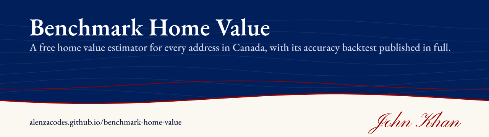
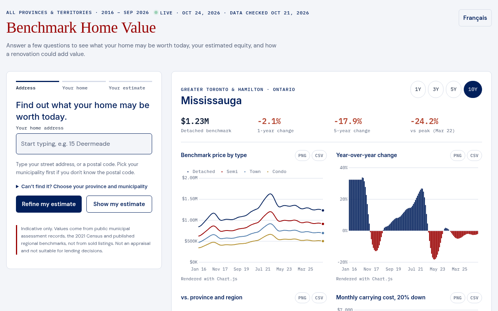

# Benchmark Home Value

**A free home value estimator for every address in Canada.**

  

Created by **John Khan**.

**Open the app:** https://alenzacodes.github.io/benchmark-home-value/

It covers all 17,250,061 addresses in Canada's National Address Register. It does what paid valuation tools and lender AVMs do, publishes its own accuracy test in full, and costs nothing. There is no account, no API key and no paid data.

## What it does

- An instant estimate with a range, a confidence score and every valuation method side by side.
- Assessment history, a calculator that brings an assessment up to today, and the regional price index.
- 2-year and 3-year forecasts and a next-month nowcast.
- Rent and yield, and what a lender will finance.
- Equity and renewal checks, a monthly equity digest and a calendar reminder.
- Saved homes tracked over time, and building comparables for condos.
- Land transfer tax and closing costs.
- Crime and safety:
  - Toronto Police neighbourhood rates, live.
  - The Statistics Canada Crime Severity Index for 41 metro areas and every province.
- Everyday places nearby (from OpenStreetMap), and City of Toronto building permits at the address.
- Liquidity (price against time to sell) and whether owning beat renting.
- Heating cost and green upgrades, and a valuator for cottages and rural homes.
- Neighbourhood momentum, an equity relocation map and twin homes in other cities.
- A printable report, in English and French.

## It keeps working when a source fails

Every input has at least two backups:

| What | First | Then | Then |
|---|---|---|---|
| The estimate | This home's assessment | Its street, then its Census block | Postal area, then the regional benchmark |
| Data files | Load | Retry with a fresh copy | Retry again, then the next source |
| Crime | Toronto Police, live | Saved copy | Statistics Canada metro, then province |
| Nearby places | OpenStreetMap servers (four of them) | Copy saved on this device | A link to the map |
| Interest rates | Bank of Canada, live | Saved rates | The page's own rate history |
| Rents | CMHC, your city | CMHC, your province | Built-in provincial averages |
| Charts | Chart library online | Local copy | Built-in drawing, then a table |
| Saving files | Browser download | Download link | Text to copy |

## Tools used to build it

| Tool | What it does here |
|---|---|
| HTML, CSS and JavaScript | The whole app is one web page, with no framework and no build step. |
| Chart.js 4.5.1 | Draws the price, forecast and backtest charts, with a local copy and a built-in canvas renderer as backups. |
| Leaflet 1.9.4 and OpenStreetMap tiles | Draws the maps. |
| JSZip 3.10.1 | Packs the backtest results into one zip download. |
| Google Fonts (DM Sans, Inter, IBM Plex Mono) | Sets the type. |
| Python 3 (standard library only) | Runs the local server and data relay (`tools/serve.py`) and the live-data updater, and built the data files from public records (`source/data-builders`). |
| Windows PowerShell and batch files | Gives one-click start and update on Windows, and acts as the backup server. |
| Playwright with Chromium | Runs the automated browser tests in `source/tests`: the 492,328-street search test, screenshots and downloads. |
| Bank of Canada Valet, Toronto Police ArcGIS, City of Toronto CKAN, Overpass API | Supply the live data feeds. |
| GitHub Pages | Hosts the free public website. |

## Results

The app was backtested on real homes. Each home was priced using only what was known at the time, then checked against the city's later assessment.

| Test | Result |
|---|---|
| Homes backtested | 974,500 (7.37 million predictions from 1.22 million assessment records in Calgary, Edmonton, Vancouver and the rest of Alberta and BC) |
| Median error, houses | 4.95% (78% within 10%) |
| Median error, all homes | 6.3% (condos are harder: 15.2%) |
| Address search | 0 of 492,328 streets, typed back in, landed on the wrong home |

The full results are in the app's Backtest section. Every chart and table there can be saved as a PNG or CSV, or all at once as a zip.

## Quick start

1. Download this repository (**Code → Download ZIP**) and unzip it.
2. On Windows, double-click **Start Benchmark Home Value.bat**. On any computer with Python, run `python tools/serve.py` and open http://localhost:8765/.
3. Optionally, run **Update live data.bat** to save today's rates, Toronto crime data and the chart library for offline use.

When it runs on your own computer, the local server also relays requests to City of Toronto permits and OpenStreetMap, which browsers can't always call directly. On the website, those features fall back to their backups and links.

## Data and sources

All sources are free and public:

- Statistics Canada National Address Register
- Municipal open assessment rolls
- 2021 Census
- CMHC Rental Market Survey
- Bank of Canada Valet API
- Statistics Canada Uniform Crime Reporting Survey
- Toronto Police Service Public Safety Data Portal
- City of Toronto open data
- OpenStreetMap
- Environment Canada climate normals
- Open Database of Educational Facilities

## Limits

Values come from public assessments, the Census and regional benchmarks, not from sold listings. This is not an appraisal.

Accuracy is tested only where cities publish assessment histories (Alberta and BC). Neighbourhood-level crime is live for Toronto only.

Sold MLS prices, title data, satellite imagery and flood layers need paid or very large data, so they are not included.

Indicative only. It is not an appraisal, a lending decision or financial advice.

---

**Created by John Khan.** © 2026 John Khan. All rights reserved.

## Licence

MIT. Built by John Khan.

---

More of my work is on my [GitHub profile](https://github.com/ALENZACODES).
