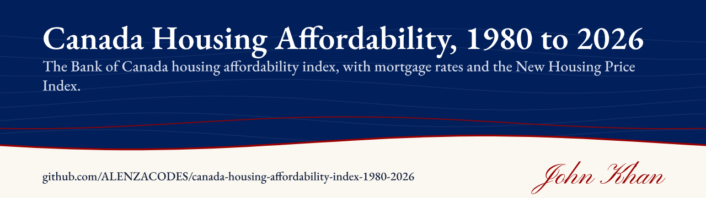
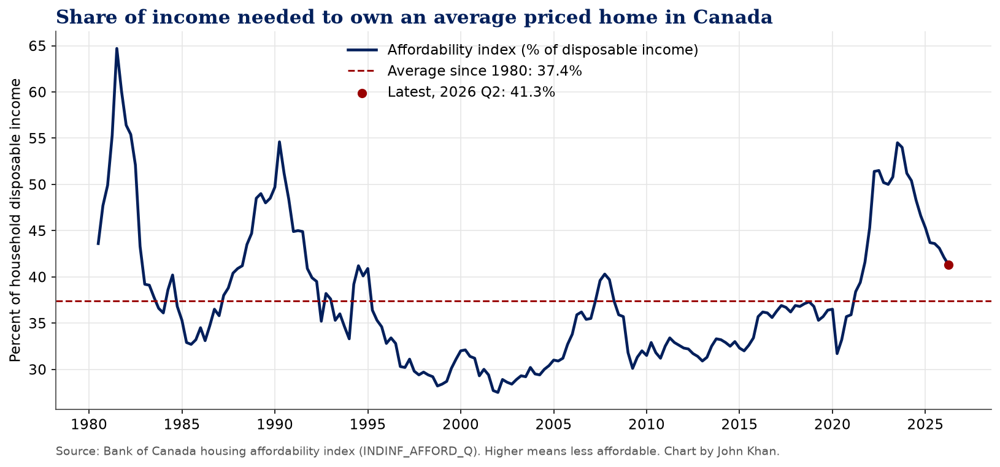
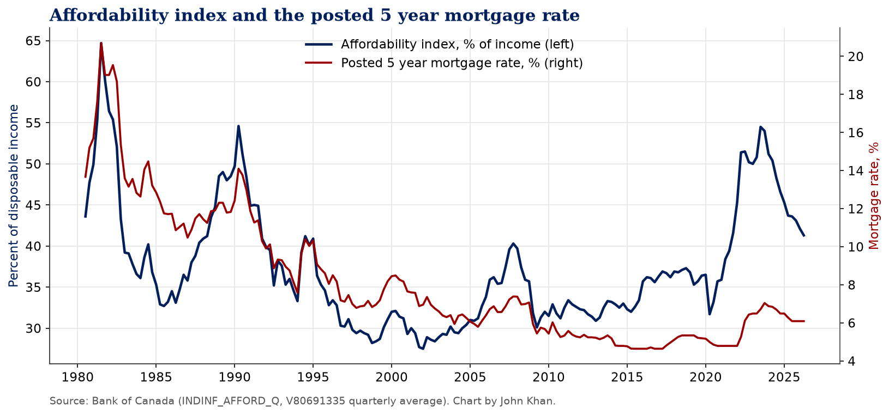
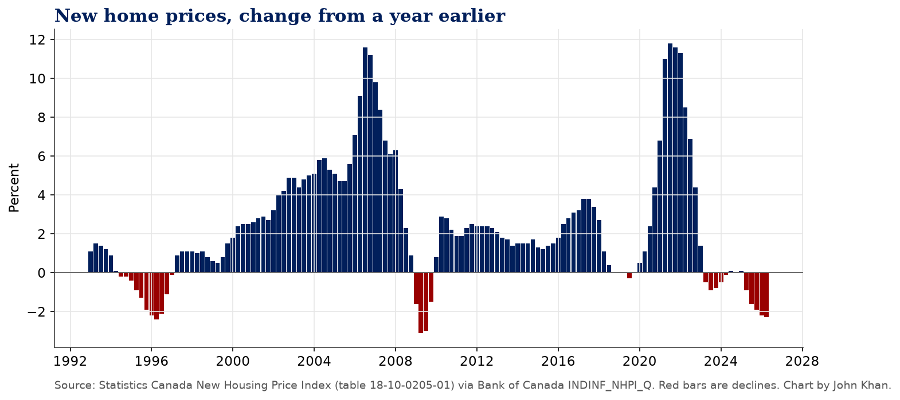

# Canada Housing Affordability Index, 1980 to 2026

**45 years of the Bank of Canada housing affordability index, with mortgage rates and the New Housing Price Index.**

[](https://www.kaggle.com/code/johnnykhan1/canada-housing-affordability-index-1980-to-2026) [](LICENSE) 

By John Khan

**Kaggle notebook:** [Canada Housing Affordability Index, 1980 to 2026 on Kaggle](https://www.kaggle.com/code/johnnykhan1/canada-housing-affordability-index-1980-to-2026)

## Question

How much of a typical household's income does owning an average priced home in Canada take today compared with the last 45 years, and how much of the swing comes from mortgage rates?

## Results

*Figures below are from the run on October 18, 2026, with the affordability index through 2026 Q2.*

**1. It is not the worst it has ever been, but it is still worse than usual.** In 2026 Q2 a household needed 41.3% of average disposable income to carry an average priced home, against a long run average of 37.4% since 1980. About 77% of past quarters were more affordable than today. The all time high was 64.7% in 1981 Q3, when the posted five year rate averaged 20.70%. The low was 27.5% in 2002 Q1.

**2. The 2020s spike matched the 1990 peak with rates a third as high.** The index jumped from 31.7% in 2020 Q2 to 54.5% in 2023 Q3, a rise of 22.8 points in about three years. That peak is almost the same as the 54.6% reached in 1990 Q2. The difference is that in 1990 the posted five year rate averaged 14.10%. In 2023 Q3 it averaged 6.72%. Prices relative to income are doing far more of the work now.

**3. Year to year, rates still drive most of the swings.** Over the full history, the yearly change in the index has a 0.85 correlation with the yearly change in the posted five year rate, and a 1 point move in that rate has gone with about a 3.1 point move in the index. In levels the link is much weaker (0.57), which is what you would expect if prices and incomes set the baseline and rates move it around.

**4. Affordability has improved in each of the last 11 quarters.** Since the 2023 Q3 peak the index is down 13.2 points to 41.3%. Over the same stretch the posted five year rate eased from 6.72% to 6.09%, and new home prices softened. On the price side, Statistics Canada's New Housing Price Index was down 2.3% from a year earlier in 2026 Q2, the fifth negative quarter in a row, and 10 of the 14 quarters since 2023 have been negative. That is a big turn from the +11.8% peak in 2021 Q3.

**What this means.** Buying is easier than it was in 2023, but a typical household still needs about 4 points more of its income for housing than the 45 year average. Getting back to average would take some mix of lower rates, flat prices and rising incomes for a while yet.

## Charts





## Quick start

```
pip install -r requirements.txt
jupyter nbconvert --to notebook --execute canada-housing-affordability-index-1980-2026.ipynb
```

On Kaggle, keep Internet on in the notebook settings, or upload the CSVs in `data/` as a dataset.

## Data and sources

* Bank of Canada Valet API, https://www.bankofcanada.ca/valet/docs
* `INDINF_AFFORD_Q` housing affordability index (definition: https://www.bankofcanada.ca/rates/indicators/capacity-and-inflation-pressures/real-estate-market-definitions/)
* `INDINF_NHPI_Q` New Housing Price Index, year over year (Statistics Canada table 18-10-0205-01, https://www150.statcan.gc.ca/t1/tbl1/en/tv.action?pid=1810020501)
* `V80691335` posted 5 year conventional mortgage rate

The notebook pulls everything live from the Bank of Canada Valet API. A snapshot of the data from the last run is in `data/`, and the notebook falls back to it if the API is unreachable.

## Licence

Code is MIT licensed. Data belongs to its publishers and is used under their terms (Bank of Canada: https://www.bankofcanada.ca/terms/, Statistics Canada Open Licence: https://www.statcan.gc.ca/en/terms-conditions/open-licence).

---

More of my work is on my [GitHub profile](https://github.com/ALENZACODES).
