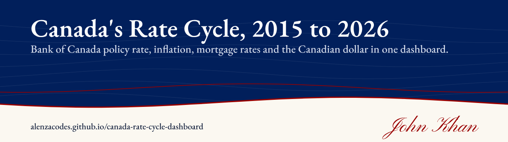
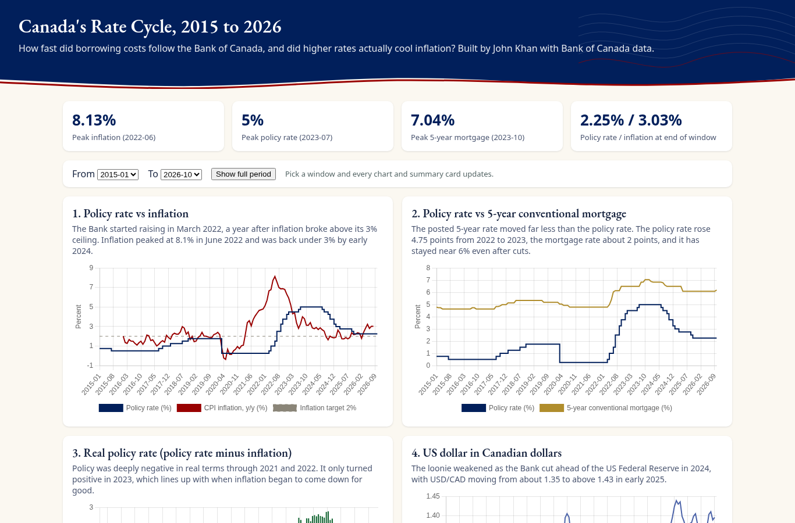
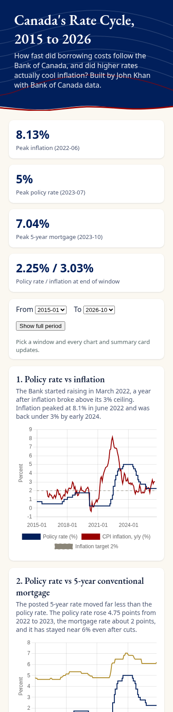

# Canada's Rate Cycle: Policy Rate, Inflation and Mortgages, 2015 to 2026

**Interactive dashboard of Bank of Canada policy rate, inflation, mortgage rates and USD/CAD, 2015 to 2026.**

   

**Live:** https://alenzacodes.github.io/canada-rate-cycle-dashboard/

An interactive dashboard that asks two questions: how quickly did borrowing costs follow the Bank of Canada through the 2022 to 2023 hiking cycle, and did higher rates actually bring inflation down?

## What it does

- Policy rate against year-over-year CPI inflation, with the 2% target
- Policy rate against the posted 5-year conventional mortgage rate
- The real policy rate (policy rate minus inflation)
- The US dollar in Canadian dollars

Pick a start and end month and every chart and summary card updates.

On a phone:

## Results

- Inflation crossed 3% in April 2021 and peaked at 8.1% in June 2022. The Bank did not start raising until March 2022.
- The policy rate rose from 0.25% to 5% while the posted 5-year mortgage rate rose by only about 2.25 points, from 4.79% to a peak of 7.04% in October 2023.
- The real policy rate only turned positive in 2023, around the time inflation began falling steadily.

## Quick start

No build step and no install. The chart library is bundled in `vendor/`, so it works offline. Open `index.html`, or serve the folder:

    python3 -m http.server 8000

then open http://localhost:8000/.

## Tests

Needs Node 20 or later. No dependencies.

    node --test

Six checks: the columns, one row per month with no gaps, that the page uses exactly the numbers in `data.csv`, that inflation is the year-over-year change in CPI, plausible ranges, and the headline figures quoted above. They run on every push through GitHub Actions.

## Data and sources

All data comes from the Bank of Canada Valet API (https://www.bankofcanada.ca/valet/docs), retrieved October 2026. The cleaned monthly table is in `data.csv`, one row per month from January 2015 to October 2026.

| Column | Series | Notes |
|---|---|---|
| `policy` | V39079, target for the overnight rate | Month-end value |
| `mortgage` | V80691335, conventional 5-year mortgage rate | Last weekly value of each month |
| `cpi` | V41690973, total CPI (Statistics Canada) | Index level |
| `inflation` | Derived from `cpi` | Year-over-year change |
| `usdcad` | FXMUSDCAD | Monthly average |

The most recent months have blank CPI and USD/CAD values until those series are published.

## Limits

- The 5-year rate is the posted rate, typical of the big banks. Most borrowers pay less than posted, so the gap between policy and mortgage rates is wider here than what households actually saw.
- Month-end and monthly-average values smooth over moves inside a month.

## Files

    index.html                the page
    style.css
    src/app.js                charts, date range and summary cards
    src/data.js               the monthly table, generated from data.csv
    data.csv                  the cleaned monthly data
    vendor/chart.umd.min.js   Chart.js 4.4.1 (MIT)
    tests/data.test.js

## Licence

MIT. Copyright 2026 John Khan. Data: Bank of Canada, used under its terms of use (https://www.bankofcanada.ca/terms/).

---

More of my work is on my [GitHub profile](https://github.com/ALENZACODES).
