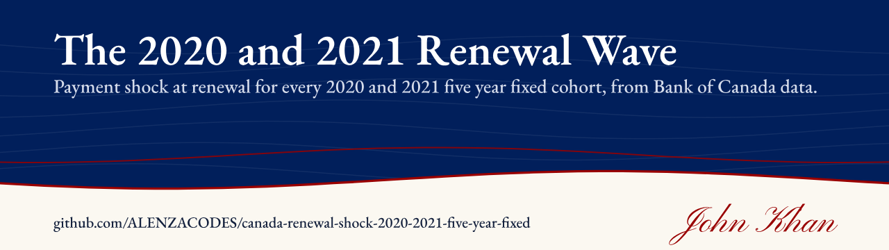
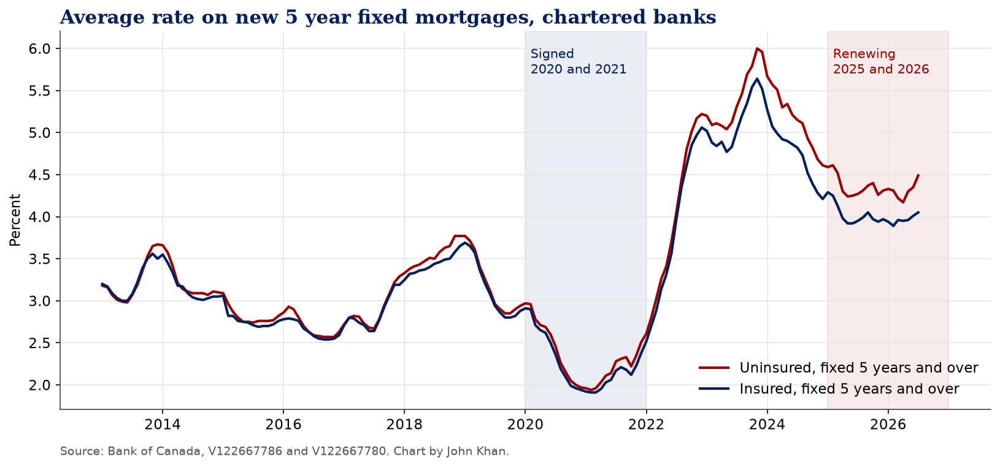
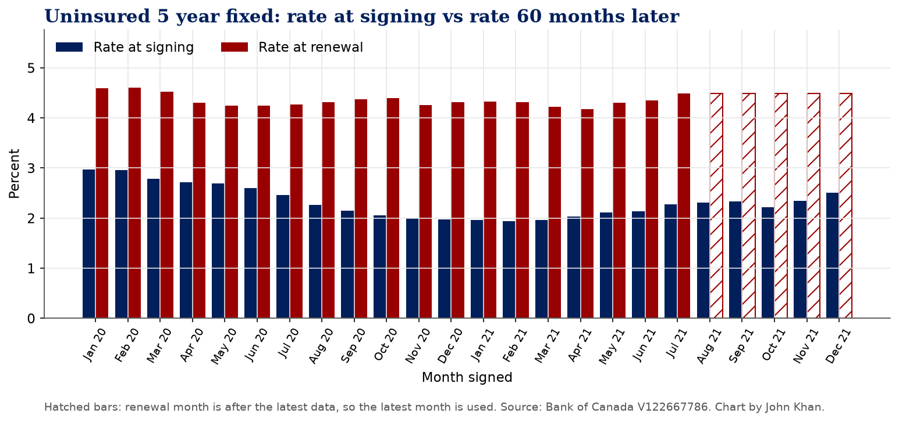
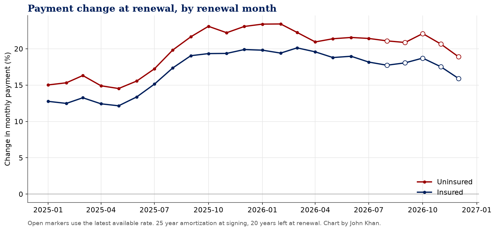

# Canada's Renewal Wave: 2020 and 2021 Fixed Rates

**Payment shock at renewal for every 2020 and 2021 five year fixed cohort, using Bank of Canada lending rate data.**

[](https://www.kaggle.com/code/johnnykhan1/canada-s-renewal-wave-2020-and-2021-fixed-rates) [](LICENSE) 

By John Khan

**Kaggle notebook:** [Canada's Renewal Wave: 2020 and 2021 Fixed Rates on Kaggle](https://www.kaggle.com/code/johnnykhan1/canada-s-renewal-wave-2020-and-2021-fixed-rates)

## Question

How big is the payment jump when a five year fixed mortgage signed in 2020 or 2021 renews at the rates lenders were actually charging five years later?

## Results

*Figures below are from the run on October 18, 2026, with rate data through July 2026.*

**1. Rates more than doubled between signing and renewal.** Uninsured five year fixed loans signed in 2020 and 2021 carried average rates between 1.94% (February 2021) and 2.97% (January 2020). Five years later, the cohorts that have already renewed faced average rates between 4.17% and 4.61%.

**2. The typical payment jump is about one fifth.** For the 19 uninsured cohorts that renewed between January 2025 and July 2026, the median payment increase was 21.4%. The range was 14.5% to 23.4%. Insured borrowers did a bit better, with a median increase of 18.8% (range 12.2% to 20.1%), because insured loans are priced lower.

**3. The people who signed in late 2020 and early 2021 got hit hardest.** The biggest jump went to the February 2021 uninsured cohort: signed at 1.94%, renewed in February 2026 at 4.31%, a 23.4% higher payment. On the $400,000 example loan that is $1,682 a month going to $2,076, or $394 more. The median across renewed uninsured cohorts on the same example loan is $367 more a month.

**4. The rest of 2026 looks similar.** The cohorts signed from August to December 2021 renew from August to December 2026. At the latest available uninsured rate (4.49% in July 2026), their payments would rise 18.9% to 22.1%. That will change if rates move before they renew.

**5. Five years of payments did not cushion it much.** After 60 payments on a 25 year schedule, about 84% of the original balance is still owed, so most of the loan reprices at the new rate.

**What this means.** Most of the 2025 and 2026 renewal wave is landing at payments around 20% higher, even after the Bank of Canada's cuts. The cuts brought renewal rates down from their 2023 peak, but they did not bring them anywhere near the 2% range these borrowers signed at.

## Charts





## Quick start

```
pip install -r requirements.txt
jupyter nbconvert --to notebook --execute canada-renewal-shock-2020-2021-five-year-fixed.ipynb
```

On Kaggle, keep Internet on in the notebook settings, or upload the CSVs in `data/` as a dataset.

## Data and sources

* Bank of Canada Valet API, https://www.bankofcanada.ca/valet/docs
* `V122667786` rate on new uninsured fixed 5 years and over mortgages, chartered banks
* `V122667780` same, insured mortgages
* Table: Interest rates charged for new and existing lending by chartered banks, https://www.bankofcanada.ca/?p=197471

The notebook pulls everything live from the Bank of Canada Valet API. A snapshot of the data from the last run is in `data/`, and the notebook falls back to it if the API is unreachable.

## Licence

Code is MIT licensed. Data belongs to its publishers and is used under their terms (Bank of Canada: https://www.bankofcanada.ca/terms/, Statistics Canada Open Licence: https://www.statcan.gc.ca/en/terms-conditions/open-licence).

---

More of my work is on my [GitHub profile](https://github.com/ALENZACODES).
