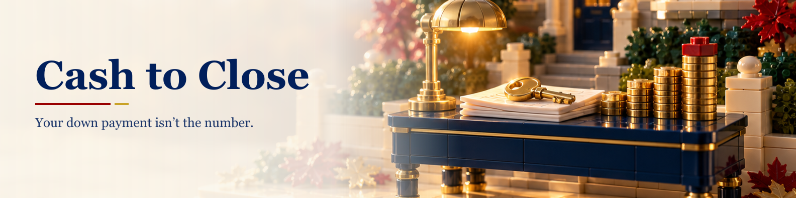
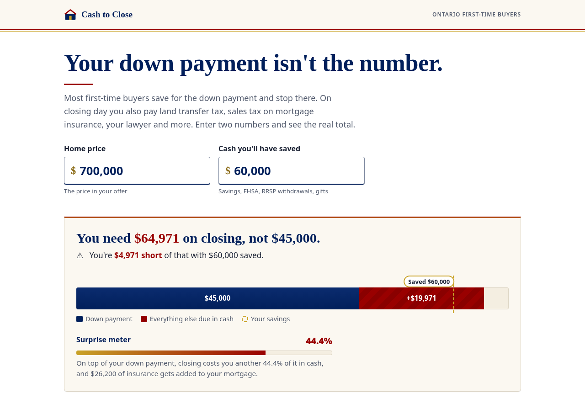

# Cash to Close

**Your down payment isn't the number.**

[](https://alenzacodes.github.io/cash-to-close/) [](LICENSE) 

Live: https://alenzacodes.github.io/cash-to-close/

Most first-time buyers in Ontario save for the down payment and stop there. On closing day they also owe land transfer tax (twice, in Toronto), 8% sales tax on their mortgage insurance, a lawyer, title insurance and adjustments to the seller. Cash to Close asks for two numbers, the price and what you've saved, and shows the real total and when each dollar leaves your account.



## What it does

- **The reveal.** A stacked bar fills with your down payment, then the other cash costs stack on top until they cross the line marking your savings. The headline tells you how much you need and whether you're short.
- **Surprise meter.** Closing costs as a share of your down payment. With the minimum down on a $700,000 Toronto home, it's about 44%.
- **When the money leaves.** Five stages from "before you offer" to "moving day". Each one shows what's due and how much of your savings is left, so you can see that the deposit is due within about a day of acceptance, weeks before the rest.
- **Every line, explained.** Open any line for one plain paragraph and a tag: paid in cash, part of your down payment, or added to your loan. Typical amounts (inspection, legal, moving) are marked approx. and can be edited in place.
- **Close the gap.** If you're short, the page doesn't stop there. It works out the highest price your savings cover with the same settings, and lets you add money you haven't counted yet (an RRSP Home Buyers' Plan withdrawal, up to $60,000 each, or a gift from family) to see where that leaves you.
- **Four toggles.** Toronto or elsewhere in Ontario, first-time buyer or not, down payment (minimum, 10%, 15%, 20%), and 25 or 30-year amortization. The 30-year option switches off when it doesn't apply.
- **Share and print.** The whole plan lives in the URL, so a link reopens it exactly. Print gives a one-page closing checklist.

## Design decisions

- **Two inputs up front, everything else later.** People leave long forms. Price and savings are enough to show the gap, and the toggles are there for anyone who wants to dig in.
- **Never colour alone.** The extra-costs segment is striped as well as red, tags carry a symbol and a word, warnings carry an icon, and selected toggles show a check mark.
- **Timing, not just totals.** A buyer with enough money in total can still be caught out by the deposit, so the timeline tracks a running balance.
- **Keyboard and screen reader.** The stages are an ARIA tablist with arrow-key, Home and End support. A polite live region reads out the new total about a second after you stop typing, so it doesn't chatter on every keystroke. Line items are native `details` elements. Focus rings are visible gold outlines. Motion is turned off when the system asks for reduced motion.
- **Colour contrast.** Navy #011F5B and red #990000 both pass WCAG AA on white for text. Gold is only used for fills, borders and focus rings, never for text on white.

## The rules it uses

All in [`rates.js`](rates.js), each with a source link and a "checked" date shown in the footer.

| Rule | Value |
|---|---|
| Minimum down payment | 5% of the first $500,000, 10% of the rest up to $1.5M, 20% at $1.5M or more |
| CMHC premium | 2.80% / 3.10% / 4.00% of the loan at up to 85% / 90% / 95% loan-to-value, plus 0.20 points for 30 years |
| Ontario sales tax on the premium | 8%, paid in cash at closing |
| Ontario land transfer tax | 0.5% to $55k, 1% to $250k, 1.5% to $400k, 2% to $2M, 2.5% above (one or two family homes) |
| Ontario first-time buyer refund | Up to $4,000 |
| Toronto land transfer tax | Same as Ontario up to $3M, then 4.40% to 8.60% (rates from April 1, 2026) |
| Toronto first-time buyer rebate | Up to $4,475 |

## Quick start

No build step and no dependencies. Open `index.html`, or serve the folder:

```
python3 -m http.server 8000
```

Tests for the tax and insurance maths (Node 18+):

```
node test.js
```

## Limits

The ownership toggle uses the stricter land transfer tax test (never owned a home). The 30-year insured amortization uses a looser one (no home you owned and lived in during the last four years), so some repeat buyers can get it too.

New builds (HST, Tarion, development charges), condo status certificates, homes outside Ontario, multi-unit and non-resident purchases, lender and appraisal fees, and partial rebates when only one buyer is a first-time buyer. It's a planning tool, not advice. The lawyer's statement of adjustments is the final word.

## Files

```
index.html   page structure and copy
style.css    layout, colour, print styles
rates.js     every rule and typical amount, with sources
calc.js      pure calculation functions
app.js       rendering, toggles, timeline, URL state
test.js      checks against published figures
```

Nothing you type leaves your browser. There's no tracking and no server.

## Licence

MIT. Built by John Khan.

---

More of my work is on my [GitHub profile](https://github.com/ALENZACODES).
