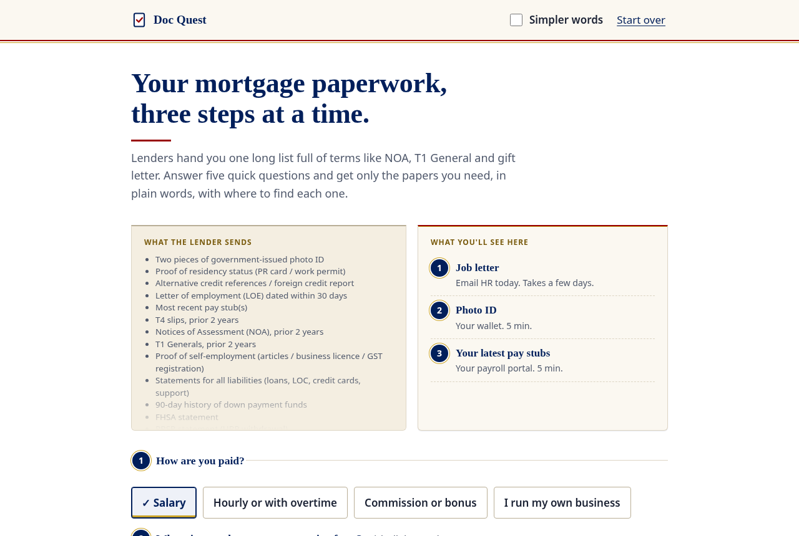

# Doc Quest

**Mortgage paperwork, three steps at a time. A plain-language document checklist for first-time and newcomer home buyers in Canada.**

[](https://alenzacodes.github.io/doc-quest/) [](LICENSE) 

Your mortgage paperwork, three steps at a time.

**Live demo:** https://alenzacodes.github.io/doc-quest/



## The problem

When you apply for a mortgage in Canada, the lender usually sends one long checklist on day one: LOE dated within 30 days, NOA for two years, T1 Generals, 90-day history of down payment funds, signed gift letter, APS with schedules. For someone who is new to Canada, or just new to buying a home, that list is the hard part. It's written in lender shorthand, it mixes things you need now with things you need after your offer, and nothing on it tells you which items take days to arrive.

The usual result is a stalled file. People gather the easy papers first, then find out the job letter takes a week, or that the bank statement they sent was a screenshot.

## Who it's for

One person: a newcomer applying for their first mortgage pre-approval, salaried or hourly, maybe with a family gift toward the down payment. English may be their second language.

## What it does

1. **Five questions.** How you're paid, where the down payment comes from, whether you've been in Canada under five years, whether you own property now, and whether someone is applying with you.
2. **Only your papers.** A salaried buyer using savings gets 5 papers before the offer. An hourly newcomer with a family gift gets 10. The tests try every combination of answers, and the longest list is 13 of the 15 pre-offer papers.
3. **Three at a time.** Items that take days to get (a job letter, a gift letter, rent references) come first and get an "Ask today" badge, so the slow clocks start early. Everything else waits in a folded list.
4. **Plain words, and where to find it.** Each card says what the paper is, where to get it (CRA My Account, your payroll portal, online banking), and roughly how long it takes. The lender's own term is shown underneath so you can match it to their email.
5. **Simpler words.** A toggle swaps every card to shorter wording and makes the text larger. The regular cards read at about a grade 7 level (Flesch-Kincaid) and the simpler ones at about grade 4.
6. **Progress that sticks.** Tick "I have this" and the next item moves up. Progress and minutes of work left are saved in your browser, so you can close the tab and come back.
7. **After your offer.** The signed offer, deposit receipt and void cheque sit in their own section so they don't crowd the pre-approval list.

Nothing is uploaded. There's no server, no account and no tracking. Your answers live in `localStorage` on your device, and "Start over" clears them.

## Accessibility

- Every control works with a keyboard, with a visible gold focus ring.
- Answer chips are real radio buttons and checkboxes inside `fieldset`/`legend`.
- After each tick, focus stays in place on the card that moves up, and a polite live region reads out the new count.
- The progress bar is a `progressbar` with values, and the badges use text and an icon, not colour alone.
- Honours `prefers-reduced-motion`. Prints as a clean full checklist.

## How it's built

Plain HTML, CSS and JavaScript. No build step, no dependencies.

| File | What's in it |
| --- | --- |
| `docs.js` | The library of 18 documents: lender term, plain and simpler wording, where to get it, minutes, wait time, and a rule for who needs it |
| `logic.js` | Pure functions: `listFor`, `ordered` (slow first, after-offer last), `nextUp`, `progress` |
| `app.js` | The questions, cards, ticking, saving and announcements |
| `test.js` | Tests for the rules and ordering, including every combination of answers |

Run it locally:

```
python3 -m http.server 8000
# open http://localhost:8000
node test.js
```

## Data and sources

The lender list is a combined checklist of what Canadian lenders commonly ask for, not one lender's list. It's backed by:

- FCAC, Getting preapproved for a mortgage: https://www.canada.ca/en/financial-consumer-agency/services/mortgages/preapproval-qualify-mortgage.html
- BMO, What to bring to your lending appointment: https://www.bmo.com/appointment/whattobring/lending
- Access Credit Union, Mortgage pre-approval checklist: https://www.accesscu.ca/media/3714/accesspreapprovalchecklist.pdf
- CRA, The Home Buyers' Plan: https://www.canada.ca/en/revenue-agency/services/tax/individuals/topics/rrsps-related-plans/what-home-buyers-plan.html
- CRA My Account: https://www.canada.ca/en/revenue-agency/services/e-services/digital-services-individuals/account-individuals.html
- Ontario Business Registry: https://www.ontario.ca/page/ontario-business-registry

## Limits

- Lenders differ. Some want more (a second job letter, an explanation letter for a gap in work) and some want less. This covers the common asks for a purchase, not refinances or rentals.
- Wait times are rough guesses, not promises.
- It's English only for now. The simpler-words mode helps, but a translated version would help more.
- It doesn't check the documents themselves. On purpose: it never sees them.

## Licence

MIT. See [LICENSE](LICENSE).

---

More of my work is on my [GitHub profile](https://github.com/ALENZACODES).
